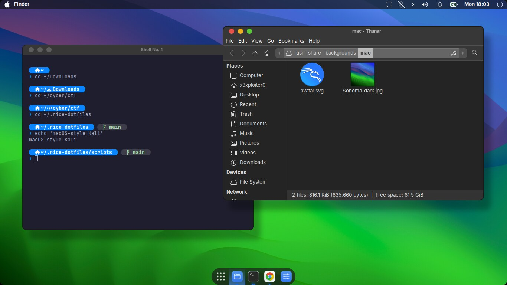
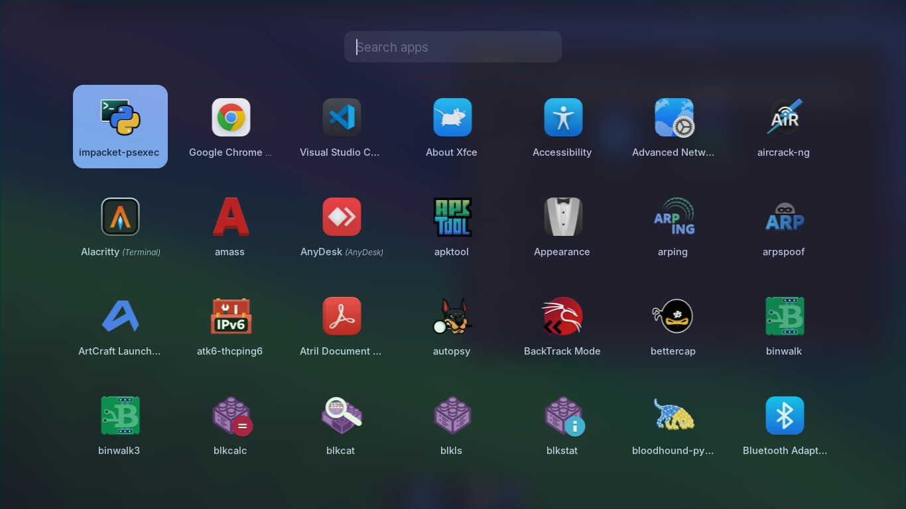
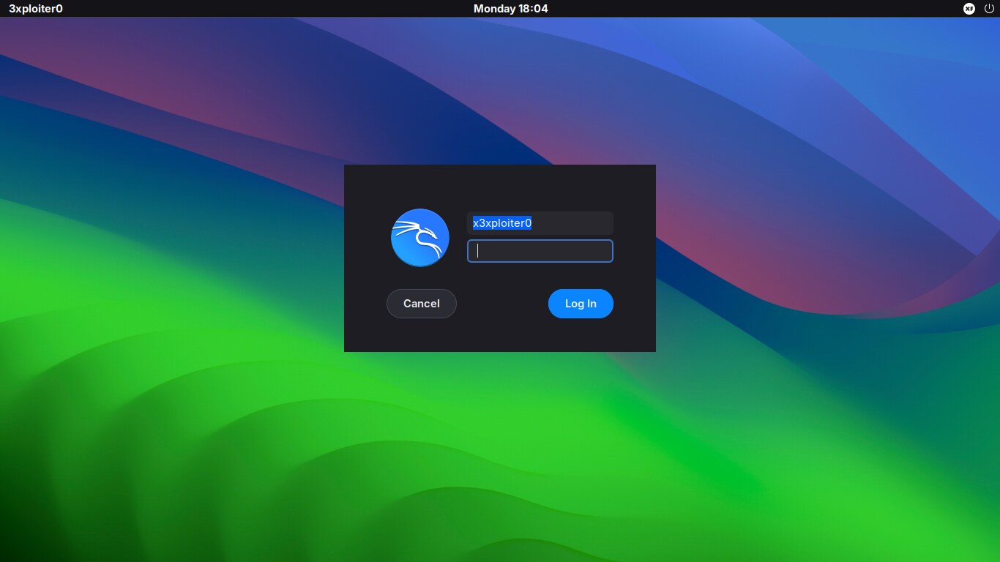
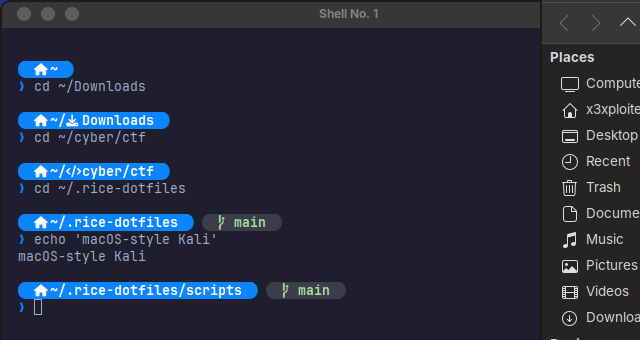
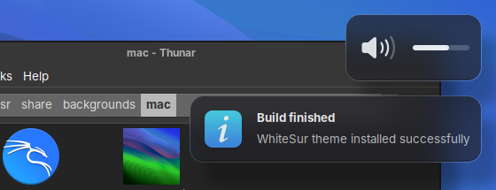

# 🍎 3xploiter0 rice — macOS-style Kali (XFCE)

A **macOS-style desktop for Kali Linux (XFCE / X11)** with a full **hacking workflow** built in. The desktop is dark **WhiteSur**; terminals and editor keep the **Catppuccin Mocha** colours.

Frosted menu bar, magnifying dock, genie-style minimize, rounded windows, styled notifications and login screen, plus a pentest toolkit that turns a fresh box into a working HTB/THM rig in seconds.



---

## 📸 Screenshots

| Launchpad (`F4`) | Login screen |
|---|---|
|  |  |

| Pill prompt (starship) | Notifications |
|---|---|
|  |  |

---

## ✨ What you get

### Desktop (macOS look)
- **WhiteSur-Dark** GTK theme, window borders (real red/yellow/green traffic lights), and **WhiteSur-dark** icons
- **Bibata Modern Ice** white cursor, **Inter** UI font, **Sonoma-dark** wallpaper (more in `~/.local/share/backgrounds/mac/`)
- **Menu bar:** translucent dark bar with the Apple logo, the **focused app's name** (like macOS), tray, clock and a **power button**
- **Dock:** [Plank](https://github.com/ricotz/plank) with **hover zoom**, launch bounce, and *hide when a window overlaps it*
- **Animations (picom):** genie-style **minimize / restore** toward the dock, pop-in on open, soft shadows, blur on glass surfaces. Apps that draw their own frame (Chrome, GTK headerbars) are excluded so they don't get a blue halo
- **Notifications:** rounded, frosted popups (`xfce4-notifyd` + CSS) with a clean volume slider
- **Launchpad** (`F4`), **Mission Control** (`F3`), hot corners, three-finger swipe workspaces
- **Login screen:** LightDM GTK greeter with a dark card, round avatar and pill-shaped fields (optional step, see below)

### Terminal & workflow
- **Starship prompt** as rounded pills: blue **path pill** with folder icons, green **git branch** pill, yellow **git status** pill, red **target** pill when you set one, and a clock on the right
- Alacritty / QTerminal / tmux / Neovim (LazyVim) / btop in **Catppuccin Mocha**
- **Hacking workflow:** one-command box setup, auto-recon, VPN toggle, reverse-shell generator, report builder, terminal auto-logging
- **Self-maintaining:** weekly update timer + unattended security patches
- **Backed up:** `rice-backup` snapshots everything into this repo

---

## 🚀 Install

Run as your **normal user** (it uses `sudo` when needed) on Kali/XFCE:

```bash
git clone https://github.com/3xploiter0/rice-dotfiles ~/rice
cd ~/rice
./install.sh
```

`install.sh` backs up your existing configs to `~/.rice-restore-<date>/`, installs packages, copies the dotfiles and scripts, **builds the WhiteSur theme, icons and cursors**, and applies the XFCE look. It does **not** touch GRUB, the boot splash or the login screen.

### Extra steps (not part of `install.sh` yet)

| Step | Command | Notes |
|---|---|---|
| **Dock (Plank)** | `bash scripts/install-plank.sh` | Plank isn't packaged in Kali, so it's **built from source** into `~/.local`. Install the build deps listed at the top of the script first. After building, copy `.config/plank` and `.local/share/plank` into place and start `plank` |
| **Login screen** | `bash scripts/setup-login.sh` | Needs `sudo`. Copies the theme/wallpaper to system folders and styles the LightDM greeter. Backs up the greeter config as `.bak` |

When done, **log out and back in**, open a terminal and run **`cheat`**.

> **Plank is unmaintained upstream** (last commit Dec 2023). It still builds and runs on current Kali, but it won't get fixes.

---

## ⌨️ Commands

Every command is documented with an example in **[COMMANDS.md](COMMANDS.md)**.
In a terminal: `cheat` (quick list), `cheat <section>` (enum/ports/web/ad/crack/linux/windows…), and **`ex <command>`** to print one example, e.g. `ex payload`. Or open [`cheatsheet/rice-card.html`](cheatsheet/rice-card.html).

### Hacking workflow
| Command | Does |
|---|---|
| `vpn htb` · `vpn thm` · `vpn down` | Connect/disconnect a `.ovpn` (put files in `~/vpn/`) |
| `htb <ip> <box>` | Target + folders + tmux workspace (nmap, listener, notes) |
| `recon <ip>` | Full port scan → auto service enum (web/SMB/FTP…) |
| `recon-web <domain>` | subfinder → httpx → nuclei *(authorized scope only)* |
| `addhost <ip> <name>` | Add/remove an `/etc/hosts` entry |
| `serve` / `gettools` | HTTP file server (IP pre-filled) / stage linpeas·winpeas·pspy·chisel |
| `revshell` | Reverse shells (bash/python/php/ps…), copies to clipboard |
| `pwncat-cs -lp 4444` | Smart reverse-shell catcher (auto TTY) |
| `note "…"` · `loot <f>` | Timestamped note / grab a file into the box's `loot/` |
| `crack <hash\|file>` | Auto-detect hash type → hashcat vs rockyou |
| `report <box>` | Build a markdown pentest report from notes + logs |
| `status` | One glance: VPN, target, box, listeners, tmux |
| `adlab` | How to set up an Active Directory practice lab (Ludus / online labs) |

### Desktop
| Keys | Does |
|---|---|
| `Super+Return` / `Super+Space` | Terminal / app launcher |
| `F4` / `F3` | Launchpad / Mission Control |
| `Super+Ctrl+Space` | Next wallpaper |
| `Super+1..5` / `+Shift` | Switch / move to workspace |
| Three-finger swipe left/right | Switch workspace (needs `libinput-gestures` + a touchpad) |

---

## 🛠️ Tweaking the look

| Want to change | Where |
|---|---|
| Dock size / zoom / hiding | `gsettings` schema `net.launchpad.plank.dock.settings` (icon-size, zoom-percent, hide-mode). Plank needs `GSETTINGS_SCHEMA_DIR=~/.local/share/glib-2.0/schemas` |
| Minimize animation | `animations = (...)` in `.config/picom/picom.conf` |
| Prompt pills & colours | `.config/starship.toml` |
| Menu bar & dock CSS | `.config/gtk-3.0/gtk.css` |
| Notification style | the `#XfceNotifyWindow` block in `gtk.css` |
| Login card | `scripts/greeter-gtk.css` (installed to `/var/lib/lightdm/.config/gtk-3.0/gtk.css`) |
| Focused-app name in the bar | `.local/bin/activeapp` (a genmon script) |

Tip: after changing configs, run `rice-backup` to snapshot them into this repo.

---

## 🧩 What's inside

```
install.sh              one-command installer (portable, backs up first)
uninstall.sh            restores your previous configs
.zshrc .tmux.conf       shell + tmux (zshrc is gitignored on the author's machine)
.config/                picom, plank, gtk-3.0/4.0, alacritty, rofi, nvim, starship, btop, cava, fastfetch, libinput-gestures
.local/bin/             all the helper commands above
.local/share/           Plank theme, wallpapers (mac/), qterminal & gtksourceview themes
scripts/                install-plank.sh, setup-login.sh, greeter-gtk.css, install-gestures.sh, generate-xfwm-theme.py
xfce-xml/               panel, window-manager, notifications and keybind settings
xfconf/                 text dumps of xfconf channels + Plank dock settings
cheatsheet/             printable HTML reference card
```

Self-update: a systemd user timer runs `update` weekly (nuclei templates + config backup), and `unattended-upgrades` handles apt security patches.

---

## ↩️ Uninstall

```bash
cd ~/rice        # the folder you cloned into
./uninstall.sh
```

It stops the rice processes, removes the helper commands and configs it added, and **restores your previous configs** from the backup `install.sh` made (`~/.rice-restore-<date>/`). Log out and back in afterwards. Packages are left installed. If you styled the login screen, restore `/etc/lightdm/lightdm-gtk-greeter.conf.bak`.

---

## ⚠️ Notes

- Built and tested on **Kali Linux rolling, XFCE (X11)**. Other XFCE distros may need small tweaks.
- **Not for Wayland.** picom, Plank and the hot corners need X11.
- The WhiteSur theme is installed from the **prebuilt release** (no `sassc` needed). Icons, cursors and wallpapers come from [vinceliuice](https://github.com/vinceliuice)'s WhiteSur projects.
- The Nerd Font isn't bundled (too large for git); the installer downloads it.
- Three-finger swipes need a physical libinput touchpad. Kali has no `libinput-gestures` apt package, so the installer fetches the upstream script. **Log out and back in once** before swiping. Re-run just this part with `bash scripts/install-gestures.sh`.
- Chrome: turn on **Use system title bar and borders** (`chrome://settings/appearance`) to get the traffic-light buttons.
- Use the recon/scanning tools **only against systems you're authorized to test.**

Made for fun. PRs and issues welcome.
